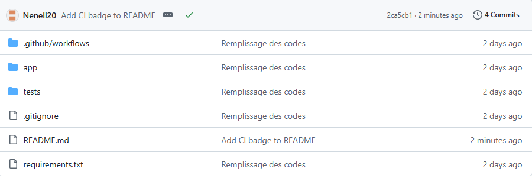
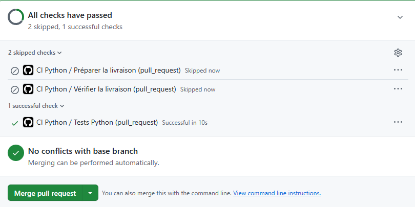

# TP GitHub project

## 1 : Créer votre projet en local

### Partie 1.4 : Effectuer le premier commit

Question 1 : la différence entre `git init`, `git add` et `git commit` est pour quoi c'est utilisé :

     `git init` est pour initialiser le projet et voir ou en est le projet.
     `git add` est pour ajouter nos fichiers, dossier aux projet final.
     `git commit` est pour enregistrer nosmodifications faites.

## 2 : Publier votre dépôt sur GitHub

### Partie 2.4 : Vérifier la configuration

Question 2 : 

1. La différence entre `un dépôt local` et `un dépôt distant` est que `un dépôt local` est la copie de votre projet stockée directement sur votre propre ordinateur alors que `un dépôt distant` est hébergé sur GitHub.

2. Le nom `origin` correspond au nom par defalt qui est donné par GitHub.

3. Le rôle de la commande `git push` sert à pousser toutes les données dans notre répertoire GitHub.

4. L'option `-u` dans `git push -u origin main` sert à associer la branche local à la branche distante.

### Partie 2.5 : Installer le projet et lancer ses tests

Question 3 : 

1. L'intéret d'un `environnement virtuel` est de pouvoir faire des tests sans risquer aucun problème. 
Le test de division par zéro peut réussir alors que le programme lève une exeception car ......

## 5 : Observer la première CI (Intégration Continue) sur GitHub

Question 4 :

1. Le premier `push` sur `main` déclanche automatiquement la `CI` car le ils sont configuré ensemble pour fonctionner.

## 6 : Provoquer une erreur et lire le diagnostique

Question 5 :

1. Le test détecte la régression car, lors de l'éxecution il y a des informations connus et vérifier. Le journal que l'icône rouge ne montre pas nous apprend l'étape qui as échoué et le nom du test.

## 8 : Bilan et compte rendu

- Dépôt GitHub : https://github.com/Nenell20/TP_GitHub-Projects_CI-CD

- Nom de la branche principale utilisé : Main

- Capture d'écran de mon dépôt GitHub : 

- Capture de mon Pull Request avant et aprés l'erreur :  
       
     

- Le nom du test qui était en échec est : `Test Python`.

- La différence entre un `test exécuté localement` et une `CI exécuté par GitHub` est qu'un `test exécuté localement` il y en as un qui dépend de l'environnement du poste et qui est lancé manuellement, tandis qu'une `CI` est lancé par GitHub et il lance les vérifications tout seul.